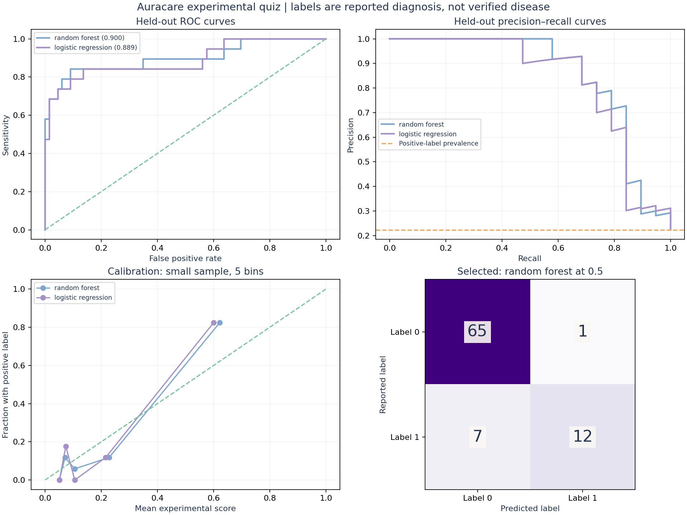

# Auracare PCOS quiz: completed experimental training

Prepared 24 October 2026. This is a research prototype for adults aged 18–45.
The model learns association with a **self-reported previous PCOS/PCOD diagnosis**.
It does not establish who currently has PCOS. A zero label means no reported diagnosis,
not a clinically confirmed absence of PCOS. No clinical performance claim follows from this experiment.

## What was completed

- Trained, tuned, and sigmoid-calibrated Random Forest and Logistic Regression.
- Selected Random Forest using nested development predictions, before inspecting the holdout.
- Saved both fitted pipelines. The selected artifact is `models/random_forest.joblib`.
- Evaluated a separate seven-feature transfer model against clinical-source records.
- Added local JSON inference, a quiz question contract, a Colab entry notebook, and integrity tests.
- No Flutter UI, public API, authentication, daily database, or GitHub deployment was created.

## Phase 1: define the task and label

Inputs are questionnaire-compatible symptoms plus age and BMI. Output is an experimental model
score for the training label. It is not a diagnosis, disease severity, fertility forecast, or probability
that an individual has PCOS. Internally, 0.5 is a fixed evaluation threshold, chosen before testing.
It is not a medically validated cutoff. User-facing inference deliberately avoids low/medium/high
risk bands, automatic reassurance, and diagnostic labels.

## Phase 2: inventory and select sources

Source folder: https://drive.google.com/drive/folders/1IS1iTmIPa5KVR73vgO6W2yXHRr38Z2v3

| File | Role in this run | Reason |
|---|---|---|
| CLEAN- PCOS SURVEY SPREADSHEET.csv | Main training/development/holdout | Self-report questions match quiz inputs |
| PCOS_data.csv | Separate transfer stress test only | Different source; clinical fields and uncertain period codes |
| cleaned_pcos_data.csv | Excluded | Reuses clinical cohort; 292 BMI values differ from raw version |
| PCOS_data_without_infertility.xlsx | Excluded | Reuses the 541 clinical profiles; not new participants |
| allData.csv | Excluded from fitting | Different categories, missing values and duplicate responses; needs a separately validated mapping |
| PCOS-Data.csv | Excluded | Ambiguous target codes, including `mb` and `mb n` |
| pcos_dataset.csv | Excluded | Laboratory/follicle-count inputs and unverified provenance |
| updated train dataset.zip | Excluded | Image task; 3,200 JPGs and a label workbook are not quiz answers |

Six CSV text snapshots supplied by Drive are included in `data/raw` for private reproducibility.
Hashes identify those exact local snapshots, not independently verified original publisher releases.
Do not publish/relicense the source data or distribute models commercially without verifying data rights.
The duplicate clinical files are not pooled. No synthetic patients or SMOTE samples were created.

## Phase 3: clean records without inventing answers

The original main survey has **465 rows**. Remove
**1 exact duplicate row**, then exclude
**41 records outside ages 18–45**.
This leaves **423 rows: 94 positive labels and 329 zero labels**.

Height contains values such as 4.7 and 13.46 in a mixed-unit column. We do not guess whether these
mean feet, feet-and-inches, or a typing error. BMI is recomputed as kg / (height in metres squared)
only for plausible stated centimetres (120–220) and kg (25–250), with a broad BMI quality range
of 10–70. These are engineering quality bounds, not disease thresholds. **4
BMI values become missing**. During each model fit, missing values are replaced with the training
fold's median and a missing-value indicator is added. Validation/test values never influence the median.

The retained survey has **33 disagreements** between
the direct regular-periods answer and the separate interval question. The direct answer is used;
the interval and bleeding-duration columns are excluded. These records are retained, not silently
removed to improve scores. Source-row references remain available for investigation.

## Phase 4: construct eight features

| Feature | Encoding / preparation |
|---|---|
| age | Years, experimental scope 18–45 |
| bmi | Recomputed kg/m²; optional at inference |
| regular_periods | 1 = regular, 0 = not regular |
| weight_gain | 1 = reported yes, 0 = reported no |
| excess_hair | 1 = reported yes, 0 = reported no |
| skin_darkening | 1 = reported yes, 0 = reported no |
| hair_thinning | 1 = reported yes, 0 = reported no |
| acne | 1 = reported yes, 0 = reported no |

Blood group, identifiers, prior diagnosis, laboratory values, ultrasound findings, and unsupported
fields are not predictors. Prior diagnosis is the target only. Diet/exercise/mood fields are omitted
from this first specification. Symptom question time windows are vague in the source, which limits
interpretation; do not invent a 7-day or 30-day training window.

At inference, unanswered binary symptom questions produce `insufficient_inputs`, not a zero.
Unknown BMI can be imputed. A reported existing diagnosis routes to a tracking journey without
rescoring. These are prototype interaction rules, not clinical eligibility screening.

## Phase 5: split before learning preprocessing

Identical eight-feature profiles receive the same SHA-256 grouping key. This keeps coarse duplicate
profiles together even if labels conflict. No conflicting profile groups occurred here. This is only
a proxy for patient identity: there are no verified survey patient IDs. Different responses from the
same person could still cross the split.

Using `StratifiedGroupKFold`, seed 42, the first of five folds is fixed as the holdout. We do not try
several splits and choose the best one.

- Development: **338 rows**, including **75 positive labels**.
- Holdout: **85 rows**, including **19 positive labels**.
- Identical predictor-group overlap: **0**.

The same partition is used for both model families. The exported models remain fitted on development
data; the holdout was not folded back into training after evaluation.

## Phase 6: train, tune, calibrate, and select

**Random Forest:** 200 trees, balanced class weights, fixed seed, maximum depth candidates
3 / 6 / unrestricted, minimum leaf-size candidates 3 / 8. A tree combines simple feature splits;
the forest averages many trees. Restricting tree depth and leaf size helps control overfitting.

**Logistic Regression:** median imputation, standardization, L2-regularized classifier; C candidates
0.1 / 1 / 10, class weight none / balanced. Scaling is fitted within each training fold.

**Nested validation:** five outer folds within development estimate candidate performance. Within
each outer training fold, three grouped inner folds choose hyperparameters using average precision.
Sigmoid calibration is then fitted with grouped cross-validation inside that outer training fold.
The resulting model predicts the outer validation fold. Thus model tuning and calibration do not
see its outer validation labels. Calibration hyperparameters are not separately tuned.

Combine the outer predictions into out-of-fold (OOF) predictions. Select the family with the higher
development OOF average precision. It was Random Forest:

- Random Forest development OOF AP: **0.6604**.
- Logistic Regression development OOF AP: **0.6272**.

After selection, tune each family on all development data using five grouped folds and fit a final
sigmoid-calibrated pipeline. Random Forest's final settings were depth **3**, minimum leaf size **8**.
Logistic Regression's final settings were C **0.1**, without class weighting. Both artifacts are retained
for comparison. The final calibration uses out-of-fold development scores and then refits the
underlying estimator on development data (`ensemble=False`). Calibration does not confer clinical validity.

## Phase 7: final holdout evaluation

| Metric | Random Forest | Logistic Regression |
|---|---:|---:|
| Accuracy | 0.9059 | 0.8706 |
| Sensitivity / recall | 0.6316 | 0.4737 |
| Specificity | 0.9848 | 0.9848 |
| Precision | 0.9231 | 0.9000 |
| F1 | 0.7500 | 0.6207 |
| ROC-AUC | 0.8995 | 0.8892 |
| Average precision | 0.8531 | 0.8317 |
| Brier score (lower is better) | 0.0854 | 0.0885 |


Random Forest correctly classified **12 of 19 positive labels**,
missed **7**, correctly classified **65 zero labels**, and made **1 false-positive
prediction at threshold 0.5. Its sensitivity is **63.2%**, which is too low to claim
that a negative quiz result rules out PCOS. An always-zero baseline already obtains
**77.6% accuracy** because positive labels are less common.

Accuracy measures all correct labels. Sensitivity measures detected positive labels. Specificity
measures correctly predicted zero labels. Precision measures positive labels among positive predictions.
ROC-AUC assesses ranking across thresholds. Average precision summarizes precision/recall ranking
(it is not the trapezoidal PR-AUC). Brier score measures squared probability error, combining aspects
of calibration and discrimination. The five-bin calibration chart is noisy with only 85 observations.

The selected model's holdout sensitivity has a 95% cluster-bootstrap interval of
**40.0%–83.3%**.
This interval resamples holdout predictor groups 1,000 times. It is conditional on the fitted model
and does not cover uncertainty from retraining, recruitment bias, or inaccurate labels.
Small exploratory age subgroups are reported in `metrics.json`; they do not demonstrate fairness.
Permutation importance reports AP drops when a feature is shuffled on the holdout. It is descriptive,
can be unstable for correlated features, and does not establish causes. No model changes were made
in response to these holdout analyses. Any subsequent tuning requires a fresh evaluation set.



## Phase 8: cross-source stress test and its limitation

The clinical source does not have a verified questionnaire-equivalent period-regularity codebook.
Rather than guess, a **separate seven-feature Random Forest** is fitted to survey development data,
omitting period regularity. It is calibrated and tuned only on that development data.

The clinical source has 536 age-eligible records. Exclude
1 predictor profile matching any survey profile, leaving
**535 records**. This seven-feature transfer model achieved:

- ROC-AUC: **0.8154**.
- Average precision: **0.7153**.
- Sensitivity at 0.5: **14.9%** (26 / 174).
- Specificity at 0.5: **99.2%**.

The low sensitivity is important evidence against generalizing this prototype into clinical screening.
This is not external validation of the main eight-feature model: the feature set differs, label
provenance is unverified, and clinical assessments may differ from self-report. It is an exploratory
stress test illustrating source/measurement differences. Clinical records never tune the main model.

## Phase 9: save the model and test inference

`joblib` saves preprocessing, classifier, and calibration together. Use the provided locked versions;
cross-version pickle compatibility is not guaranteed. Load only trusted artifacts.

```bash
python -m venv .venv
# Windows PowerShell:
.venv\Scripts\Activate.ps1
# macOS / Linux alternative:
# source .venv/bin/activate
python -m pip install -r requirements.txt
python train.py
python -m unittest -v
python predict.py --input examples/quiz_answers.json
```

The test suite has 11 tests covering source hashes, split/group isolation, ambiguous unit handling,
BMI recomputation, label-independent grouping, training-only imputer statistics, serialized model
inference, JSON feature ordering, unknown-answer abstention, optional BMI, age limits, known-diagnosis
routing, and malformed input rejection. These are software/data integrity checks, not clinical tests.
The actual example output is saved in `outputs/example_prediction.json`; its inputs are synthetic.

## Phase 10: personalized quiz and Flutter integration

`quiz_contract.json` lists the eight input fields, encoding, and source wording. The six binary symptom
answers are required for scoring; the source did not support confident arbitrary missing-symptom
inference. Follow-ups can personalize the experience without changing the trained feature contract:
ask about an irregular-cycle answer, clarify an unknown answer, and confirm old entries before reuse.
Any newly collected duration/severity answers are initially descriptive only, not hidden model inputs.

The current prototype is Python inference, not a mobile UI. A later authenticated backend can call
`predict_quiz(answers)` and return its JSON to Flutter over HTTPS. Do not place a Python joblib file in
Flutter and expect Dart to execute it. Do not silently reroute personal health records to external AI
services. Persistence, consent, authentication and access controls need separate implementation.

Display a symptom summary with experimental wording. `experimental_model_score` is a developer
output; it must not be displayed as a validated personal probability. Outside the trained age range,
or when core answers are missing, the function returns a status without a score.

## Phase 11: future daily records and retraining

Daily logging can support reminders and descriptive history. The present source is cross-sectional,
so it cannot validate next-day prediction, PCOS progression, or changing disease probabilities.
Do not treat the model's own predictions as clinical labels. Collect consented repeated records with
timestamps, user identifiers, defined symptom windows, and separately verified clinical outcomes.
Later evaluate using user-disjoint and time-aware splits. A large number of days from a few users
is not the same as a large number of independent participants. Retrain offline on a schedule after
reviewing label quality and drift; do not self-update after every daily log.

## Framework, runtime and timing

Python **3.12.14**, scikit-learn **1.8.0**, pandas **2.2.3**,
NumPy **2.3.5**, SciPy **1.17.0**, Matplotlib **3.10.8**,
joblib **1.5.3**. Testing uses the standard-library `unittest` framework.
No GPU, TensorFlow, neural network, or LLM was used. The current CPU run took
**28.33 seconds** for training and numerical evaluation before final chart
rendering. Data review, writing code, tests and packaging take additional time. Rerun time depends on
hardware; initial environment installation can take several minutes.

## Read the delivered files

- `README.md`: short execution guide.
- `WALKTHROUGH.md`: this full explanation.
- `Auracare_PCOS_Colab.ipynb`: upload the ZIP into Colab, then train/test/predict.
- `pcos_data.py`: deterministic preprocessing and feature mapping.
- `train.py`: nested validation, tuning, calibration, holdout scoring, transfer stress test and charts.
- `predict.py`: validated local JSON inference.
- `test_pipeline.py`: integrity tests.
- `models/`: two fitted models and selected-model metadata.
- `outputs/`: audit, metrics, split manifest, predictions, confidence intervals, importance and plots.
- `data/raw/`: private source CSV snapshots; contains health records, do not commit publicly.

## Technical references

- https://scikit-learn.org/stable/common_pitfalls.html
- https://scikit-learn.org/stable/modules/generated/sklearn.model_selection.StratifiedGroupKFold.html
- https://scikit-learn.org/stable/modules/calibration.html
- https://scikit-learn.org/stable/modules/model_evaluation.html
- https://www.monash.edu/medicine/mchri/pcos/guideline

Remaining work before real-user assessment: establish source permissions and label provenance,
clinical review of the questionnaire and result wording, recruitment of an independent target-user
cohort including clinically assessed non-PCOS participants, prospective evaluation, and privacy controls.
