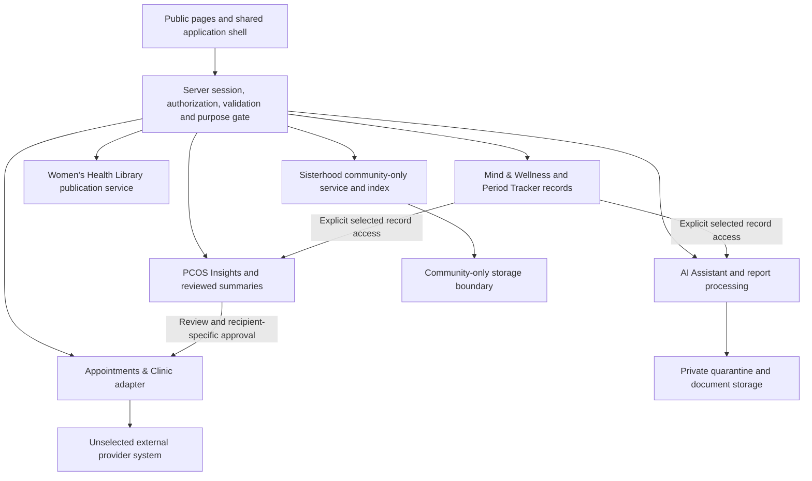

# Architecture

> Mobile prototype update (2026-10-25): Flutter UI, Navigator, ChangeNotifier and an in-memory synthetic repository now implement the local demo. Records, resources, quiz and account/privacy have separate service boundaries. No backend/model/authentication is connected. The following server architecture remains proposed; the documentation-only statement describes the prior audit baseline. See [Mobile UI handoff](MOBILE_UI_HANDOFF.md).

## Existing architecture

Documentation only: no executable frontend/backend, database, authentication, AI, reports, clinics or community integration. No technology stack is selected. Earlier Next.js/PostgreSQL suggestions were unimplemented options. See [audit](../README.md).

## Proposed boundaries

Choose runtime, storage and identity through an architecture decision before implementation. A modular monolith is an option to limit operational overhead, not a selected framework. Domain boundaries do not require separate databases prematurely.

All components are proposed. Sisterhood has no private-record read path. Shared internal identity does not grant shared data access; public community IDs/display names are separate with restricted account linkage.

Frontend owns interaction, selection and preview; server owns authentication, owner/role authorization, purpose/recipient consent, validation, persistence and credentials. Route guards alone are insufficient. Public marketing/education can be cached; health pages/responses require private/no-store policies and cannot enter static public output.

## Data flow and integrations

Private write: server session → validate ownership/input/version/purpose → transaction → acknowledgement → refreshed history. Reuse canonical records via authorized references. Derived artifacts store source IDs/versions, method version, coverage and review state. Changed/deleted sources invalidate affected summaries or mark them outdated; approval for a changed payload must be renewed. Already delivered/downloaded copies cannot be silently recalled.

AI receives a bounded context assembled from explicitly authorized selections, never database-wide access. Report flow: private upload validation/quarantine/malware handling → extraction draft with page/span/uncertainty → user correction/review → selected downstream use. User verification confirms transcription, not a clinical diagnosis. Treat uploaded text as untrusted input, not model instructions.

Clinic adapters distinguish synthetic demo, requested, pending, provider-confirmed, declined, cancelled and unknown states. Verify callbacks/replay handling; no invented directory metadata or availability. Sharing approval, dispatch, receipt and booking confirmation are separate events.

Library publishing controls sources/reviewer metadata/revisions. Community services, search, suggestions, attachments and moderators cannot join private records into community content or infer topics from private history.

## Security and decisions

Server secrets stay server-side. Apply least privilege, private storage, encryption/key review, minimal logs, rate limits, consent rechecks in jobs, deletion/invalidation and tested restore. None exists yet. Open: stack, providers, region, session model, content storage, queues, notifications, clinical/moderation owners, age policy and availability/recovery budgets. See [Backend](BACKEND.md), [Data model](DATA_MODEL.md) and [Security](SECURITY_AND_PRIVACY.md).
